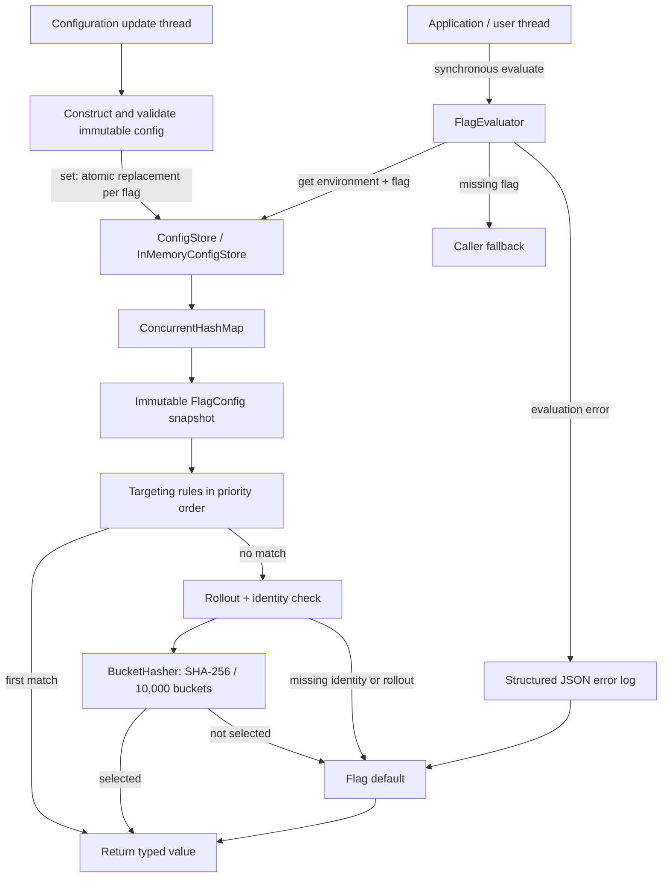
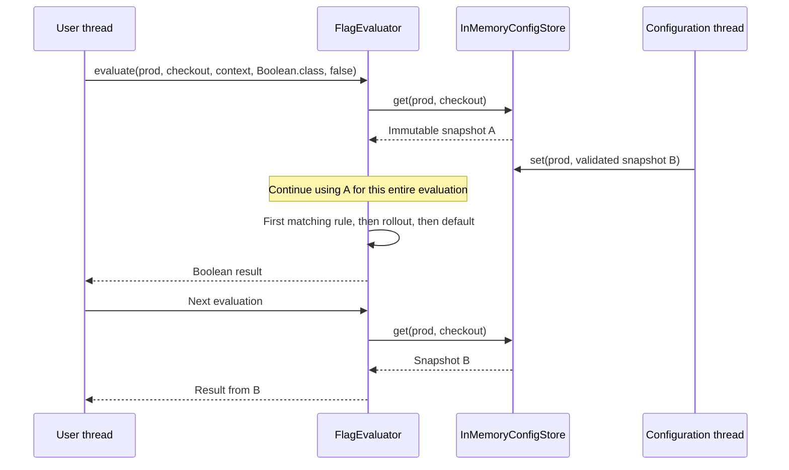

# In-process feature flags

Java 17+ and Maven. Supports Boolean, String, and Integer flags with targeting, sticky rollouts, environment isolation, and live updates.

```sh
mvn test
mvn -q -DskipTests package dependency:copy-dependencies -DincludeScope=runtime
java -cp 'target/classes:target/dependency/*' com.razorpay.featureflags.Demo
```

## Architecture



An error before a configuration can be read returns the caller fallback. A requested type that differs from the configured type also returns the caller fallback and logs the error, because that flag's default cannot satisfy the requested type.

## A user thread's path



All evaluation work runs on the calling thread, including hashing and error logging. Evaluation creates no background tasks and performs no network calls. The store publishes a configuration with one `ConcurrentHashMap.put`; a reader retains the single snapshot returned by `get`. An overlapping update can yield the old or new snapshot, and cannot mix their fields. Replacement is atomic for one environment/flag pair; updates to several flags are separate operations.

## Usage

```java
var store = new InMemoryConfigStore();
var evaluator = new FlagEvaluator(store);
store.set("prod", new FlagConfig("checkout", FlagType.BOOLEAN, false,
        List.of(new TargetingRule(
                new Condition("tier", Condition.Operator.EQUALS, "pro"), 1, true)),
        new RolloutConfig(50, true, "checkout-experiment")));

var context = new EvaluationContext("tenant-1", "user-42", Map.of("tier", "free"));
boolean enabled = evaluator.evaluate("prod", "checkout", context, Boolean.class, false);

// Publish a validated replacement; existing evaluator instances see it on their next call.
store.set("prod", new FlagConfig("checkout", FlagType.BOOLEAN, true, List.of(), null));
```

Import the API from `com.razorpay.featureflags` and collections from `java.util`.

## Evaluation and configuration contracts

- Lower rule priority numbers run first. Equal priorities retain input order. The first match wins over rollout.
- `EQUALS` compares exact scalar values; `IN` accepts a nonempty collection. Missing attributes do not match. Attribute and condition values support String, Boolean, and Integer.
- Every default, rule result, and rollout result must match the flag type. Invalid configurations fail during construction, before replacing an existing entry.
- Configurations copy their rule lists and condition collections; contexts copy their attribute maps. All accepted contained values are immutable scalars.
- A null rollout disables rollout. A null bucket group selects independent bucketing; a nonblank group selects shared bucketing.
- Rollout requires nonblank tenant and user IDs. Targeting can still match when either identity is missing. Unselected or unidentified users receive the flag default.
- Bucketing hashes length-prefixed UTF-8 components: environment, tenant, user, namespace (`flag` or `group`), and flag name or bucket group. Length prefixes prevent ambiguous concatenations; the namespace prevents a group name from colliding with an independent flag key.
- The first eight SHA-256 bytes form an unsigned big-endian integer, reduced modulo 10,000. A user is selected when the bucket is below `round(percentage * 100)`. Percentages must be finite and in [0, 100]; resolution is 0.01 percentage points, rounded to the nearest bucket.
- Equal group, environment, tenant, user, and percentage give equal rollout selection across flags. Different flag keys provide independent assignments. Hash collisions remain possible; isolation separates keys and configurations rather than guaranteeing different individual bucket numbers.
- Increasing a percentage retains already selected users if their identity and bucketing key stay the same. Changing the environment, tenant, user, flag name, or bucket group can change assignment.
- Missing flags return the caller fallback. Runtime evaluation failures return the configured default when available and of the requested type, otherwise the caller fallback. Invalid API arguments such as a null requested type are programming errors.
- Pass wrapper classes (`Boolean.class`, `String.class`, `Integer.class`) to evaluation. The requested type must match the configured type exactly; a null caller fallback is allowed.

Errors carry `event`, `environment`, `flag`, and an exception through SLF4J. The included Logback configuration writes JSON to the console; an embedding application can supply its own logging configuration. Logging occurs synchronously, so an error's latency includes the configured appender.

## Checkpoint coverage

| Checkpoint | Implementation | Tests |
| --- | --- | --- |
| CP1 | Immutable models, validation, environment-keyed store | `ConfigStoreTest` |
| CP2 | Typed evaluation, EQUALS / IN, precedence, defaults | `FlagEvaluatorTest` |
| CP3 | Stable hashing, shared and independent rollout | `BucketHasherTest` |
| CP4 | Atomic replacement, structured errors, concurrent access | `LiveUpdateTest` |
| CP5 | Runnable `Demo`, combined evaluation scenarios | `FeatureFlagIntegrationTest` |
